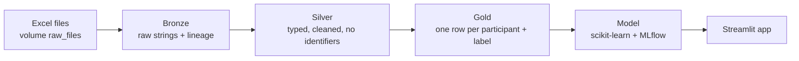

# MLops_bal_pipeline

An end-to-end data pipeline on Databricks Free Edition: messy Excel files go in, clean Delta tables, tracked machine-learning models and a small Streamlit demo come out.

**All data in this project are simulated.** They imitate a tuberculosis bronchoalveolar lavage (BAL) study, with realistic problems built in (mixed ID and date formats, censored lab values, duplicate participants, impossible values). Nothing here is a clinical tool, and no result should be read as a biological finding.

## What it shows

- Bronze, silver and gold Delta tables in Unity Catalog, each stage reading only the previous one
- Cleaning logic written as tested functions in `src/`, called from short notebooks
- Quality checks that stop the pipeline when something is wrong
- Idempotent runs: running the pipeline twice gives the same row counts
- MLflow experiment tracking and a model comparison against a baseline
- A Streamlit app that loads the trained model

## Architecture



| Layer | Tables | What happens |
|---|---|---|
| Bronze | `metadata`, `bal`, `pbmc`, `luminex_raw`, `luminex_selection`, `treatment` | Every column kept as a string, plus `_source_file`, `_source_sheet`, `_ingested_at` |
| Silver | `metadata`, `bal`, `treatment` | IDs, dates and numbers standardised, categories mapped, impossible values nulled, direct identifiers removed |
| Gold | `model_table` | One row per participant with a binary label (favourable treatment outcome) |

## Repository layout

```
MLops_bal_pipeline/
  README.md
  requirements.txt
  notebooks/
    00_setup_schemas       create schemas and the volume, check the uploaded files
    01_bronze              import every sheet as strings with lineage columns
    02_silver              clean and type metadata, BAL and treatment
    03_gold                join into one row per participant, define the label
    04_train               compare models and log everything to MLflow
    00_run_all             run the four stages in order
  src/
    cleaning.py            pure functions: IDs, dates, numbers, category mapping
    quality.py             data quality checks
  tests/
    test_cleaning.py       unit tests for the cleaning functions
  app/
    streamlit_app.py       demo app
```

## How to run

1. In Databricks, create a catalog `clinical_portfolio` and clone this repo into a Git folder.
2. Run `notebooks/00_setup_schemas` on **Serverless** compute. It creates the `bronze`, `silver` and `gold` schemas and the volume `raw_files`.
3. Upload the five Excel files (`metadata`, `bal`, `pbmc`, `luminex`, `treatment`) to `/Volumes/clinical_portfolio/bronze/raw_files`. The same notebook can check that they are there.
4. Run `notebooks/00_run_all`, or run `01_bronze` to `04_train` one after another.
5. Run it a second time. Row counts should be identical.

Expected row counts after a run:

| Table | Rows |
|---|---|
| `bronze.metadata` | 10,024 |
| `bronze.bal` and `bronze.pbmc` | 30,279 each |
| `bronze.luminex_raw` | 12,000 |
| `bronze.luminex_selection` | 1,000 |
| `bronze.treatment` | 3,125 |
| `silver.bal` | 30,092 |
| `gold.model_table` | 2,981 |

## Cleaning rules

Every rule lives in `src/cleaning.py`, and the counts below are measured on the simulated files.

| Problem | Rule | Function | Rows affected |
|---|---|---|---|
| Duplicate participants | Keep the latest `date_seen` per ID | window function in `02_silver` | 24 metadata rows removed (10,024 to 10,000 participants) |
| Inconsistent IDs (`SP00007`, `sp00007`, `37269`) | Upper-case, trim, add the `SP` prefix | `clean_id` | 174 metadata IDs had no `SP` prefix |
| Mixed date formats | Try eight formats in order; keep the raw text; null anything outside a valid range | `parse_date` | all rows parse; two-digit years shifted back a century where needed |
| Blank spreadsheet rows | Drop rows with no ID | filter in `02_silver` | 187 blank baseline BAL rows removed |
| Impossible BAL values | Null negative cell counts and processing times outside 1 to 600 minutes | `null_outside` | 763 negative cell counts and 217 bad processing times across the four visits |
| Impossible heights and weights (zeros, negatives, 999 codes, 1863 cm) | Null values outside 100 to 220 cm and 10 to 250 kg | `null_outside` | 338 and 58 heights, 358 and 50 weights (two measurements each) |
| Censored lab values (`<0.89`) | Replace with half the limit | `parse_number` | for example 207 of 3,000 values for one cytokine |
| Missing-value tokens (`ND`, `nan`, `not done`) | Convert to real nulls | `parse_number` | all numeric columns |
| Spelling and case variants (`Neg`, `NEG`, `1+`, `+1`) | Lookup tables, then report anything unmapped | `map_values`, `report_unmapped` | categorical columns |
| Treatment outcomes | Group into favourable and unfavourable; unmapped values stay null and leave the model | `map_values` | 3,125 rows to 3,115 participants; 133 have no usable outcome |
| Direct identifiers | Compute age, then drop surname, first name and birth date | in `02_silver` | all rows |

## Tests and quality checks

- `tests/test_cleaning.py` has four unit tests on real messy values from the files. Run them on your own machine with `python -m pytest` from the repository root.
- `assert_unique` stops the pipeline if a key is duplicated (for example after a bad join).
- `unparsed_dates` stops silver if a date was present in the source but could not be parsed.
- `null_report` prints the percentage of nulls per column so that gaps are visible.

## Model and results

The target is a favourable treatment outcome (cured or completed), which is about 77% of the 2,981 participants with an outcome. Features are the metadata fields and baseline BAL measurements. Treatment information is not used as a feature, to avoid leakage. Three models were compared with 5-fold cross-validation on a training split, then scored once on a held-out test split.

| Model | CV AUC | Test AUC | Test PR-AUC |
|---|---|---|---|
| Dummy (base rate) | 0.500 | 0.500 | 0.769 |
| Logistic regression | 0.686 | 0.645 | 0.833 |
| Random forest | 0.702 | 0.665 | 0.846 |

Both models beat the baseline, but only modestly. Most of the signal comes from a single column, the GeneXpert rifampicin result: on my laptop run, dropping it took the logistic regression's test AUC from about 0.68 to about 0.54. This is a workflow demonstration. The effect is built into the simulated data, and it says nothing about real patients.

## Limitations

- Simulated data, small effect, no clinical use.
- The `luminex` and `pbmc` tables are loaded into bronze but are not yet used in silver or gold.
- The model uses a single train and test split; there is no hyperparameter search.
- There is no monitoring, retraining schedule or continuous integration yet.

## Next steps

- Clean the Luminex and PBMC tables and add follow-up visits as features.
- Add a scheduled Databricks job and a GitHub Actions workflow that runs the tests on every push.
- Add model explanations (SHAP) and a calibration check.
- Repeat the workflow on real, de-identified data.